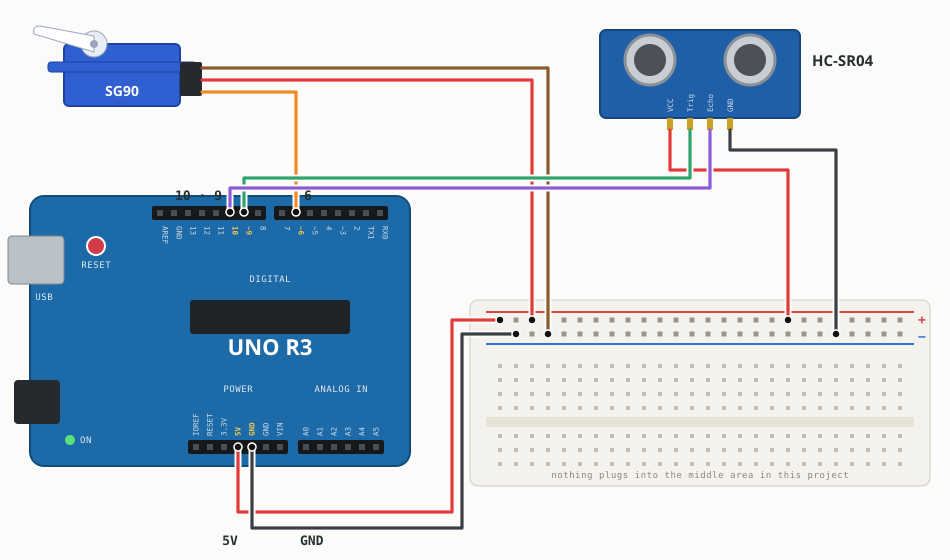

# Automatic Lid

A touchless box lid built with an Arduino UNO. Wave your hand within 30 cm of the ultrasonic sensor and a servo lifts the lid. Take your hand away and it closes again.

## Demo Version

**Wokwi simulation:** [open in Wokwi](https://wokwi.com/projects/480511927623989249)

## How it works

1. The Arduino sends a 10 µs pulse to the HC-SR04's **Trig** pin, which makes the sensor emit an ultrasonic ping.

2. The sensor holds its **Echo** pin HIGH for as long as the sound takes to travel to the object and back. `pulseIn()` measures that time in microseconds.

3. The time is converted to distance. Sound travels at about 343 m/s, which is 0.0343 cm/µs, and the signal goes there and back, so:
   distance [cm] = 0.0343 × time [µs] / 2

4. If something is between 0 and 30 cm away, the servo turns to 0° and opens the lid. Otherwise it goes back to 90°. Closed position is 90°, not 0°, because of how the servo is attached to the lid.

5. reading is printed to the Serial Monitor, which made testing and debugging much easier.

## Hardware

| Part | Notes |
|------|-------|
| Arduino UNO R3 (Elegoo) | |
| HC-SR04 ultrasonic sensor | Trig → pin 9, Echo → pin 10 |
| SG90 micro servo | Signal → pin 6 |
| Breadboard + jumper wires | 5V and GND shared through the power rails |
| A light cardboard box | The SG90 is small, so the lid needs to be light |

## Wiring

The Arduino has only one 5V pin, so 5V and GND go to the breadboard's + and − rails, and both the servo and the sensor take power from there.

Circuit diagram for Wokwi: [`diagram.json`](diagram.json)

## Code notes

The code is in [`AutomaticLid.ino`](AutomaticLid.ino). It needs the [Streaming](https://github.com/janelia-arduino/Streaming) library (installable from the Arduino Library Manager) for the `Serial << value << endl` output style. `Servo.h` comes with the Arduino IDE.

A few decisions I made along the way:

- **No sensor library.** The kit comes with an SR04 library, but I wanted to understand what actually happens on the pins, so I wrote the trigger pulse and the `pulseIn()` measurement myself.
- **A timeout that matches the sensor's range.** By default `pulseIn()` waits up to one second for an echo, which would freeze the whole program. The HC-SR04 reaches about 400 cm, which gives an echo of about 23,300 µs (800 cm ÷ 0.0343 cm/µs). I set the timeout to 25,000 µs to leave some margin.
- **Handling "nothing in front".** When no echo comes back before the timeout, `pulseIn()` returns 0, so the distance is also 0. The condition `distance > 0 && distance <= 30` makes sure an empty reading closes the lid instead of opening it.

## What I learned

- Connecting a sensor to an actuator: using distance from the HC-SR04 to control a servo. This sense-and-react loop is the basis of many projects, like robots and automatic doors.
- How a breadboard is connected inside. My first attempt shorted 5V to GND and the board kept shutting off. Tracking that down taught me to check every wire before plugging in USB.
- How the HC-SR04 works and how to read a datasheet and the Arduino docs for timing and units (µs vs ms, m/s to cm/µs).
- Choosing data types: `unsigned long` for time, `float` for distance.
- Keeping `loop()` readable: one block for printing, one block for the lid, one `delay()` at the end.

## Ideas for next steps

- Close the lid slowly with a `for` loop instead of snapping shut.
- Add a buzzer beep when the lid opens.
- Average several readings to filter out noise.
